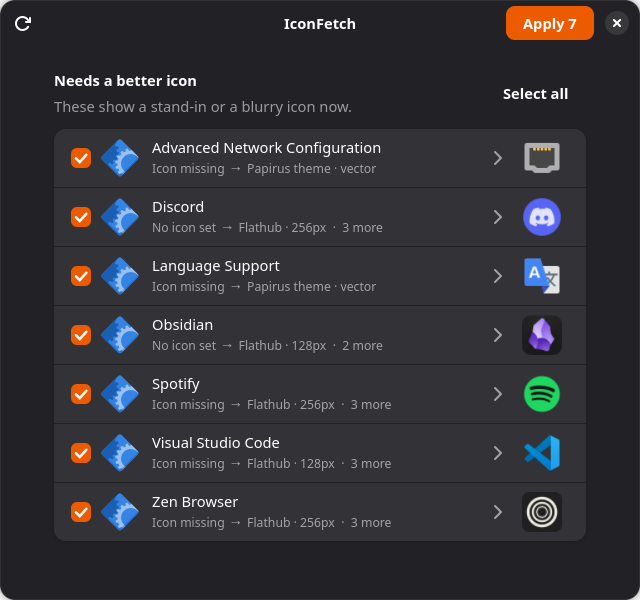

# IconFetch

Gives your installed apps on Linux their real icons, and applies them right away.
The dock and app menu update within a second, with no sign-out needed.



IconFetch lists every app with the icon it shows now, then fills in the icons
it finds online as they arrive. Apps that show a stand-in, nothing at all, or a
blurry icon are ticked for you. Tick any others you'd like to swap, choose among the options by
clicking the icon on the right, and press **Apply**. Every change can be undone.

## Where icons come from

Checked in this order, most official first:

| Source | What it is |
|---|---|
| Flathub | The icon an app's developers publish in its AppStream listing |
| Snap Store | The icon a snap's publisher uploaded |
| App folder | Icons shipped next to an unpacked download (e.g. `~/Downloads/zen/…/default128.png`) |
| Website | The app's homepage: its manifest icons, touch icon or a large favicon |
| Brand icons | [dashboard-icons](https://github.com/homarr-labs/dashboard-icons), brand icons by app name |
| Papirus theme | Full-colour theme icons, for system tools whose generic icon names (e.g. `preferences-system-network`) Adwaita no longer ships |

Each app's sources are searched side by side; the app's website is only
asked when no app store has its icon. Finds are kept for a week in
`~/.cache/iconfetch`, so IconFetch opens in seconds; **Look again** (Ctrl+R)
or `--fresh` asks every source anew.

An app is matched by its ID, program, window class or icon name, and by its
name only when the name isn't an ordinary word. That way "Files" never picks up
an unrelated app called Files. On the Ada desktop, Ada's own apps are left alone.

## How applying works

The desktop reads `~/.local/share/applications` before the system folders. For
a system app, IconFetch writes a copy of its entry there under the same desktop
ID, with `Icon=` pointing to a PNG in `~/.local/share/iconfetch/icons/`. Your
own entries are edited in place, after a backup in
`~/.local/share/iconfetch/backup/`. The PNG's name changes with the picture, so
nothing serves a cached copy, and GIO's app monitor tells the shell at once.

Undo removes IconFetch's copy, or restores the original `Icon=` line.

### Keeping up with your apps

A copy stands in for the app's own entry, so IconFetch keeps it in step:

- **The app updates its entry** (a new action, a changed command): the copy is
  rebuilt from the new entry, with the icon you chose.
- **The app is uninstalled**: the copy and its icon are removed, so no broken
  launcher stays behind. An app only counts as uninstalled when its entry is
  gone from every standard app folder *and* its program is gone too.
- **IconFetch's icon file was deleted**: the app gets its own icon back.

This runs by itself. With systemd (most distributions), a user service starts
within seconds of an app folder changing, and once at sign-in. Elsewhere, a
sign-in entry runs it. It also runs whenever you open IconFetch, and as
`iconfetch refresh`.

## Install

On any distribution:

```sh
curl -fsSL https://raw.githubusercontent.com/Officialbabs/iconfetch/main/install.sh | sh
```

It checks for Python 3.9+, PyGObject, GTK 4.6+ and libadwaita 1.1+, and asks
before installing whatever is missing with your package manager (apt, dnf,
zypper, pacman, apk, xbps or emerge). Then it installs IconFetch for you alone,
in `~/.local`, with an entry in your app menu, and sets up the background
refresh (`--no-watch` skips that). Run it again to update.

Every change is tested on Ubuntu 22.04 and 24.04, Debian 12 and 13, Fedora,
Arch Linux, openSUSE Tumbleweed, Alpine and Void Linux.

Or as a package, from the [latest release](https://github.com/Officialbabs/iconfetch/releases/latest):

| Distribution | Install |
|---|---|
| Debian, Ubuntu, Mint, Pop!_OS | download `iconfetch.deb`, then `sudo apt install ./iconfetch.deb` |
| Fedora | `sudo dnf install https://github.com/Officialbabs/iconfetch/releases/latest/download/iconfetch.rpm` |
| Arch, Manjaro, EndeavourOS | download `PKGBUILD` into an empty folder, then `makepkg -si` |

To remove a one-line install (it puts every original icon back first):

```sh
sh ~/.local/lib/iconfetch/install.sh --uninstall
```

Before removing a package, run `iconfetch revert`. Packages refresh at sign-in;
for the instant refresh after installs and updates, turn on the watcher once:

```sh
systemctl --user enable --now iconfetch-refresh.path
```

## Use

```sh
iconfetch               # the window
iconfetch list          # what each app shows now and what was found (* = would apply; --fresh to look again)
iconfetch apply         # apply the ticked-by-default ones without the window
iconfetch apply vlc     # apply the best find for specific apps (desktop IDs)
iconfetch revert        # put every original icon back (or: iconfetch revert vlc)
iconfetch refresh       # catch up with app updates and removals (runs by itself)
```

## Packaging

`install.sh` also stages a system-wide install for packagers:

```sh
sh install.sh --prefix=/usr --destdir="$pkgdir" --no-deps
```

That gives `/usr/bin/iconfetch`, the code in `/usr/lib/iconfetch`, the desktop
entry, icon and AppStream metadata under `/usr/share`, the refresh service and
watcher in `/usr/lib/systemd/user`, and a sign-in entry in `/etc/xdg/autostart`.
`packaging/` has the `.deb` builder, the RPM spec and the PKGBUILD that the
release workflow uses. Pushing a `v*` tag that matches `__version__` builds
all three, installs each on its distribution, and publishes the release.

## Tests

```sh
python3 -m unittest discover -s tests
python3 tests/smoke_ui.py              # opens the window and clicks through it
python3 tests/smoke_ui.py --old-adw    # the same, as on libadwaita 1.1
```

The tests run in throwaway data folders with a fake network, so they never
touch your real launchers.

## License

GPL-3.0. See [LICENSE](LICENSE).
